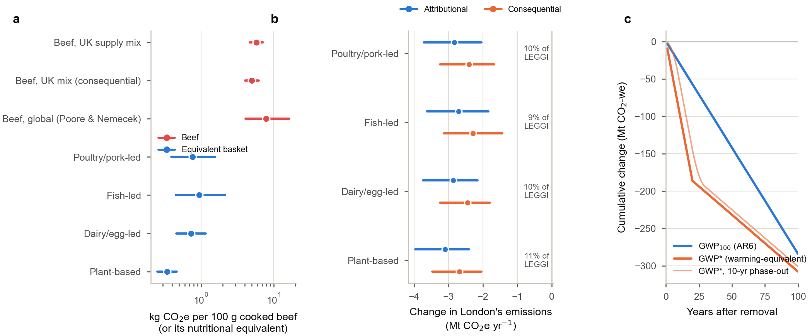

# What if beef disappeared from the menu?

**Nutrition, emissions and economics of removing beef — London and Imperial College London**

Imperial College London's in-house caterer removed beef from every menu in October 2024 to cut
carbon emissions. This repository answers three questions about that kind of policy with one
open, reproducible model chain and a Nature-style paper:

1. **Biology.** If we don't eat beef, can we get the same nutrition from other foods? Which foods, and how much of them?
2. **Carbon.** If beef were replaced by nutritionally equivalent food, would emissions rise or fall? By how much (% and t CO₂e)? What share of London's emissions is that?
3. **Economics.** What does removing beef from campus outlets actually change once markets and diners respond? How does it affect students (diet, nutrition, satisfaction, welfare)? How could all of this be measured?

📄 **Paper:** [`paper/main.pdf`](paper/main.pdf) · **Every calculation, step by step:** [`paper/supplementary.pdf`](paper/supplementary.pdf) and [`docs/CALCULATIONS.md`](docs/CALCULATIONS.md)



## Headline results

All numbers are generated by the code. Medians are given with 90% Monte Carlo intervals; see `results/key_numbers.json`.

**1. Nutrition**
- Replacing beef's **protein** is easy. 100 g of cooked lean beef is matched by about 91 g of chicken breast, 168 g of tofu or 196 g of mycoprotein.
- **Zinc** and **vitamin B₁₂** are the hard part, especially once bioavailability is accounted for.
  - Matching beef's absorbable zinc takes 684 g of chicken breast or 1 kg of lentils.
  - No unfortified plant food contains B₁₂.
  - Exceptions: mycoprotein (Quorn) and pumpkin seeds are zinc-rich, and wild venison and pork loin come closest to matching everything.
- Using foods alone and staying within twice beef's calories, **no diet without ruminant meat matches beef's absorbable B₁₂**.
- With fortified foods or a B₁₂ tablet (plus a little zinc), every diet works.
  - Poultry/pork-led, fish-led, dairy/egg-led and plant-based baskets match all key nutrients.
  - They need 228–296 g of food and 1.5–1.8× the calories per 100 g of beef replaced.

**2. Emissions**
- UK-consumed beef: **34.7 kg CO₂e per kg** (Poore & Nemecek global mix: 66.4). That is **5.6 kg CO₂e per 100 g** cooked.
- Nutritionally equivalent baskets: **0.36–1.58 kg CO₂e**, i.e. **72–93% lower**.
- If all Londoners replaced beef this way, emissions would fall by **2.8 (2.0–3.7) Mt CO₂e/yr**.
  - That is equivalent to **≈10% (7–13%) of London's territorial emissions** (LEGGI 2023: 28.6 Mt) and ≈3–4% of its consumption-based footprint (88 Mt).
  - Almost all of the saving happens on farms *outside* London.
  - With global-average beef footprints the saving is 5.7–6.4 Mt (20–23% of LEGGI).
  - Under GWP* the 20-year warming-equivalent saving is 3.3× the GWP₁₀₀ figure.

**3. The campus ban (Imperial)**
- Taste Imperial bought ~9.5 t of beef a year before removal (FOI data), about 79,000 meals.
- A procurement inventory books a **−232 t CO₂e/yr** saving.
- Market leakage (pass-through 0.78 long run, 0.28 short run), off-campus beef and substitute foods leave **−150 (−83 to −223) t/yr in the long run** and **−47 t/yr in year one**. That is 0.06% of Imperial's footprint.
- The ban only cuts emissions if pass-through exceeds ≈0.25.
- At fixed prices, diners lose ≈£2.75 per forgone beef meal (≈ price ÷ dish elasticity), about **£214k/yr**. The monetised climate benefit is **£41k/yr** at £277/t, so the cost is ≈£1,700 per tonne avoided.
- Nutrition:
  - For the average student the effect is negligible.
  - A student who ate beef on campus twice a week loses ≈11% of the women's RNI for zinc and ≈27% of the RNI for B₁₂.

## Reproduce

```bash
pip install -r requirements.txt
make analysis   # runs all models (~30 s): results/, figures/, paper/generated/, docs/CALCULATIONS.md
make paper      # builds paper/main.pdf and paper/supplementary.pdf (pdflatex + bibtex)
make test       # unit and end-to-end tests
```

`python scripts/run_all.py --quick` does a fast run with fewer Monte Carlo draws.

## Repository layout

| Path | Contents |
|---|---|
| `data/` | All inputs, each row annotated with its source: `foods.csv` (composition, DIAAS, bioavailability classes), `emission_factors.csv`, `beef_supply.csv` (UK origin × system mix), `markets.csv` and `cross_price.csv` (elasticities), `drv_uk.csv`, `imperial_foi_meat.csv`, `parameters.toml` (every scalar, with distribution and source) |
| `src/beefwhatif/` | `nutrition.py` (equivalents, diet LPs), `emissions.py` (beef mix, scaling, GWP*), `economics.py` (equilibrium displacement model), `welfare.py` (nested-logit welfare, diner nutrition), `analysis.py` (orchestration and Monte Carlo), `figures.py`, `report.py` (LaTeX macros, tables, Markdown) |
| `scripts/` | `run_all.py`; `foi_meat_purchases.py` (parses Imperial's FOI workbooks); `check_macros.py` |
| `results/` | CSV and JSON outputs |
| `figures/` | Main and Extended Data figures (PDF and PNG) |
| `paper/` | `main.tex` (Nature-style article), `supplementary.tex` (all calculations), `references.bib`, `generated/` (auto-generated numbers and tables), PDFs |
| `tests/` | `pytest` suite |

## Methods in one paragraph

- **Nutrition.** Nutrients come from USDA FoodData Central and UK product labels. Protein is weighted by DIAAS. Iron, zinc and B₁₂ are adjusted for bioavailability. Single-food equivalents and minimum-emission linear programmes (HiGHS) find the baskets.
- **Emissions.** Alternative foods use Poore & Nemecek's (2018) distributions. Beef uses a bottom-up UK supply mix built from Defra, CIEL, PRISM and FAO GLEAM data. GWP₁₀₀, GWP₂₀ and GWP* are all reported.
- **Scaling.** Results are scaled with the UK supply balance and ONS populations, and compared with LEGGI and London's consumption-based inventory.
- **Campus economics.** An equilibrium displacement model covers nine food markets, using UK demand elasticities and short- and long-run supply elasticities.
- **Welfare.** A nested-logit compensating variation, capped at the cost of buying beef off campus.
- **Measurement.** Supplementary Note 12 proposes an evaluation design with a power calculation.

## Limitations

- Nutrient equivalence is assessed per portion against lean mince.
- Bioavailability factors are food-level rather than meal-level.
- Alternative-food footprints are global means, which is conservative.
- Elasticities come from national-market studies.
- The welfare model rests on an assumed dish elasticity that has never been measured on a UK campus.

All of these are explicit inputs in `data/`, so they are easy to change.

## Citation and licence

See `CITATION.cff`. Code: MIT. Text and figures: CC BY 4.0. Data are © their original publishers (sources listed in each file).
Built with the help of an AI assistant (Claude, Anthropic); every input is traceable to a cited source.
